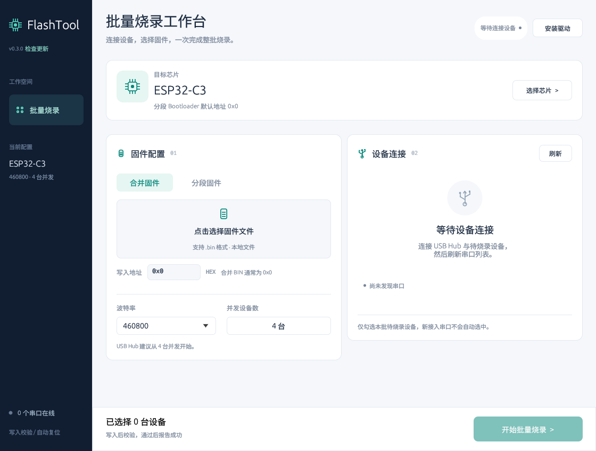

# FlashTool

轻量 Rust 原生桌面烧录工具，面向 Windows 10/11 x64 和 USB Hub 批量生产。无需安装 Python、Rust 或原乐鑫烧录工具。

[下载 Windows 版本](https://github.com/xiaoxiaoawei/hw_hub/releases) · [版本记录](CHANGELOG.md) · [驱动说明](assets/drivers/README.md)



## 工作流程

1. **选择芯片**：默认 ESP32-C3，其他型号可在芯片选择器中切换。工具会检查固件镜像头，并与实际连接的芯片比较。
2. **配置固件**：选择合并 BIN，或添加多个 BIN 和十六进制地址。常用分段模板会随芯片切换 bootloader 地址；实际地址以固件发布说明为准。
3. **勾选设备**：刷新串口并选中本批设备；新出现的端口不会自动勾选。
4. **开始批量烧录**：每台独立连接、检查 Flash 容量、压缩写入、MD5 校验并复位。仅全部步骤成功后标记成功；单台失败不影响其他设备。
5. **保存结果**：导出含芯片、固件布局摘要、耗时及结果的 CSV，便于追踪生产批次。

支持 1–16 台同时烧录，更多设备排队处理；默认并发 4 台，波特率 460800，可选择 115200 或 921600。“停止排队”仅取消尚未开始的设备，正在写入的设备会继续完成校验。

## 自动检查更新与版本邮件

启动后在后台检查 GitHub 最新正式 Release，每天最多自动请求一次；侧栏“检查更新”可随时手动查询，也可在更新窗口关闭自动检查。检查失败会显示网络错误并保留重试入口；没有正式 Release 时明确提示尚未发布。

发现比当前版本更新的正式版时显示版本号、更新说明和官方 Windows 下载入口；若附件尚未上传，显示“发布包尚未上传”并提供发布页。下载由用户选择，烧录任务保持独立运行。设置保存于 Windows 的 `%LOCALAPPDATA%\FlashTool` 用户目录。

更新来源固定为本仓库 GitHub Releases。预发布和草稿不会作为升级提示；下载地址须属于本仓库的正式版本资产，按语义版本比较（例如 `0.10.0` 高于 `0.9.0`）。

**版本邮件使用 GitHub 的 Releases 订阅机制**：在软件的更新窗口点击“订阅版本邮件”，进入仓库后选择 `Watch → Custom → Releases`，并在 [GitHub 通知设置](https://github.com/settings/notifications) 启用 Email。发布流程先上传并核验附件，再将草稿转为正式 Release，使订阅通知对应一个可下载的版本。

GitHub 会依据每个账号的订阅、邮件偏好及投递策略发送通知；软件不会读取邮箱、保存邮箱密码或自行发送邮件。未启用仓库 Releases 邮件订阅的账号不能保证收到邮件。Actions 构建邮件与 Releases 版本邮件是两种通知，可在 GitHub 分别配置。

## 芯片与地址

| 芯片 | 常用独立 bootloader 地址 | 合并镜像起点 |
| --- | --- | --- |
| ESP32、ESP32-S2 | `0x1000` | `0x0`，要求前 4 KiB 为 `0xFF` 填充，正确镜像头位于 `0x1000` |
| ESP32-S3、C2、C3、C6、H2 | `0x0` | `0x0` |

常用分区表地址为 `0x8000`、应用为 `0x10000`。固件地址始终以实际工程导出说明为准。ESP8266 不在本版本支持范围。

开始前会冻结固件内容，检查镜像芯片 ID、4 KiB 地址对齐、擦除范围重叠和 16 MiB 地址上限；连接后严格核验 Flash JEDEC ID 与实际容量。工具不执行整片擦除、不烧 eFuse、不启用加密或 Secure Boot。安全下载模式因无法提供本版本要求的校验而拒绝写入。

USB Hub 建议使用独立供电，先完成单台验证再增加并发。连接失败时可降至 115200，检查线材、供电、串口占用和下载电路；部分板卡需要按住 BOOT 后按 RESET。

## 手动安装驱动

提供 CH343/CH9102、CP2102/CP210x 两类手动安装入口（此前提到的 SP2102 按 CP2102 处理）。仅用户点击后才触发 UAC，由 Windows PnPUtil 校验并安装原厂驱动，程序等待实际退出码。

本次默认发布包**不含内置驱动 ZIP**：当前云环境无法访问官方镜像。可在界面选择完整官方 ZIP，或把包放在 EXE 相邻的 `drivers/ch343.zip`、`drivers/cp210x.zip`；有包时界面会明确显示来源。具备原厂包后可构建真正内置的版本，参见[驱动打包说明](assets/drivers/README.md)。

## 构建与验证

安装 `rust-toolchain.toml` 指定的 Rust。Windows 原生构建还需要 MSVC Build Tools 的 Desktop development with C++。

```sh
cargo fmt --all -- --check
cargo clippy --locked --all-targets -- -D warnings
cargo test --locked --all-targets
cargo run --locked
```

```powershell
# 构建支持手动导入驱动 ZIP 的版本
.\scripts\build-windows.ps1 -AllowMissingDrivers
# 下载官方包并构建内置驱动版本（保留原厂完整包及许可）
.\scripts\build-windows.ps1 -FetchDrivers
```

版本由 `Cargo.toml` 的 package.version 管理。界面、`--version`、Windows 文件版本资源和发布包名从该值生成；`Cargo.lock` 与标签必须一致。变更版本时使用版本工具，并在 CHANGELOG 中记录面向用户的变化。已发布标签保持不变，后续修复使用新版本。

```sh
python3 scripts/bump-version.py --help
python3 scripts/bump-version.py --check
# 先为下一版本写好 CHANGELOG，再预演并更新版本：
python3 scripts/bump-version.py 0.4.0 --dry-run
python3 scripts/bump-version.py 0.4.0
```

提交并验证新版本后创建对应 Git 标签，例如 `git tag -a v0.4.0 -m "FlashTool v0.4.0"`，再推送分支和标签以触发发布。标签必须与 Cargo 版本相同；发布后不移动标签、不覆盖已有资产，修复使用新版本。

GitHub Actions 验证 `vX.Y.Z` 标签与 Cargo 版本一致，通过格式、静态检查和测试后在 Windows 构建。正式 Release 统一使用 `FlashTool vX.Y.Z` 标题，上传版本 ZIP、源码 ZIP 和 SHA256 校验文件，验证成功后才发布并标记 Latest。已发布标签及附件保持不变；可手动选择只构建或发布一个已存在的版本标签。Latest 保持指向较高的正式版本，补发旧版本时保留更新版本的 Latest 标记。

发布工具也可从本地验证过的标签和构建产物完成相同流程：

```sh
# 离线核对当前版本的标签、提交、Windows ZIP 与 SHA256SUMS
bash scripts/publish-release.sh --assets-dir dist --check
# 确认计划后访问 GitHub，上传并核验草稿附件，最后正式发布
bash scripts/publish-release.sh --assets-dir dist
```

发布工具要求已有的 Git 标签与 Cargo 版本一致，并且 Windows ZIP 及其校验文件已生成；网络或权限错误会中止发布。版本邮件以正式发布事件为前提，上传失败不会将未完成的草稿发布出去。

### 只读命令行

```sh
cargo run --locked -- --version
cargo run --locked -- --list-ports
cargo run --locked -- --check '0x0:/path/merged.bin'
cargo run --locked -- --check --chip esp32s3 '0x0:/path/merged-s3.bin'
```

`--check` 只检查文件，不连接设备、不写入 Flash。摘要包含所选芯片、分段地址、长度和内容。

### 云环境

使用现有 `/workspace/hw_hub` checkout。每个云任务已隔离，不需要额外创建 Git worktree。

```sh
export CARGO_HOME=/workspace/.toolchains/cargo
export RUSTUP_HOME=/workspace/.toolchains/rustup
export PATH="$CARGO_HOME/bin:$PATH"
bash scripts/setup-cloud.sh
# 本次准备的 MinGW 支持 Linux → Windows 交叉构建
source /workspace/.toolchains/mingw/env.sh
cargo build --locked --release --target x86_64-pc-windows-gnu -j 4
```

## 验证边界

自动测试覆盖多芯片固件预检、容量/擦除边界、并发上限、单台失败隔离、停止排队、进度、驱动包检查和 CSV 导出。云环境可验证原生界面与 Windows 交叉构建，未连接真实 ESP 设备，不能代替 Windows 实机量产验收；新增芯片必须在相应实物上验证。

原始参考附件是乐鑫烧录工具发布包，并非源码。本工程没有分发其 EXE、私有固件或设备日志。
